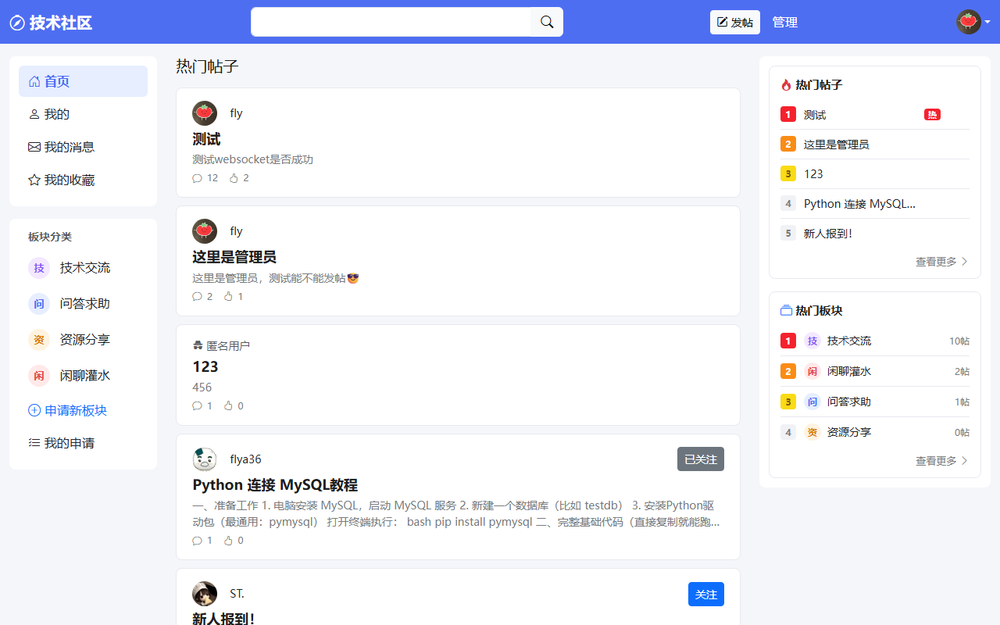
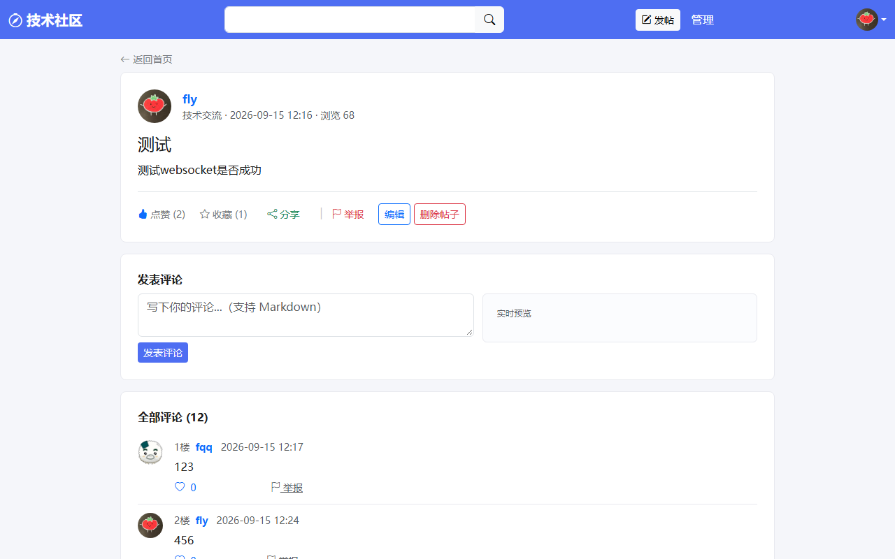
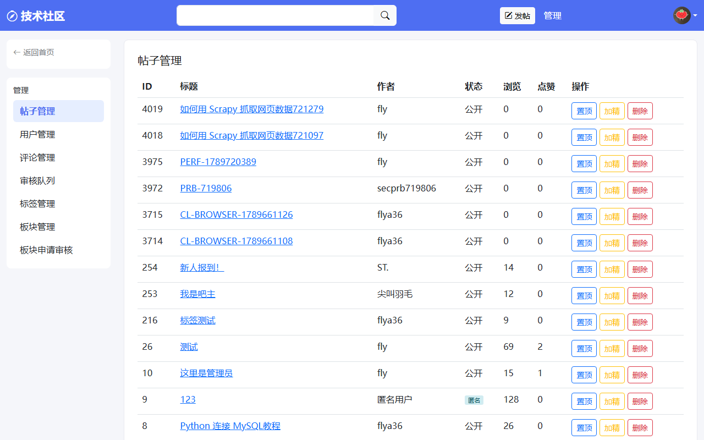
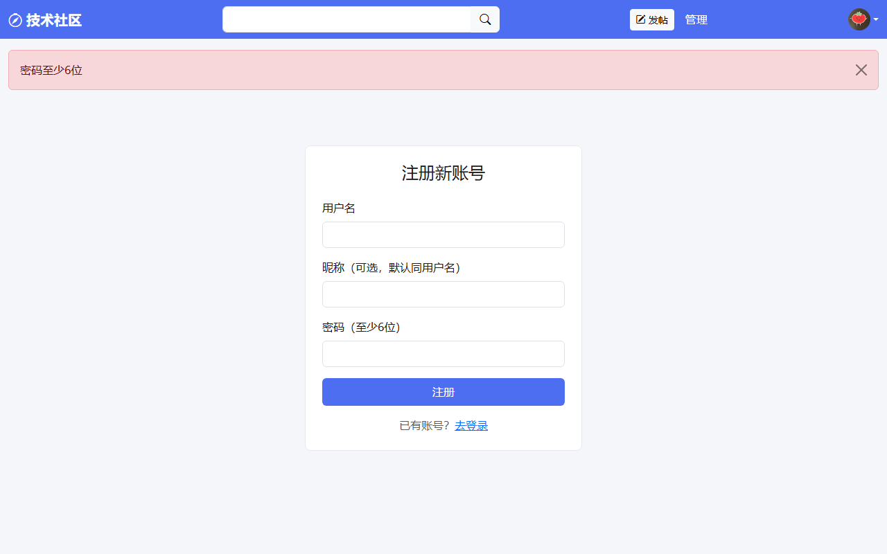

# AI 增强型知识社区

基于 **Flask + MySQL** 的网页版论坛 / 知识社区系统，内置 **RAG 智能问答**与 **SocketIO 实时推送**，并配套一套只读优先的安全自动化测试。

`Python 3` · `Flask` · `Flask-SocketIO (gevent)` · `pyodbc` · `MySQL 8+` · `ChromaDB` · `sentence-transformers`

## 项目规模

| 维度 | 数据 |
| --- | --- |
| 数据表 | 11 张（user / board / board_application / tag / post / comment / knowledge_chunk / favorite / post_tag / post_like / notification） |
| 路由与事件 | 74 个（HTTP 路由 + SocketIO 事件） |
| 业务服务模块 | 19 个（`backend/services`，按功能划分） |
| 后端代码量 | 约 2.3 万行（`*.py`） |
| 安全自动化用例 | 109 条（约 3.8k 行，静态扫描 + 动态探测 + 授权矩阵） |
| E2E 用例 | 4 套（板块 / 发帖编辑 / 标签 / 回归） |

## 界面截图

| 首页帖子流 | 帖子详情 |
| --- | --- |
|  |  |

| 管理后台 | 注册校验（短口令拦截） |
| --- | --- |
|  |  |

其余截图见 [`screenshots/`](screenshots)，其中 `s_*` 开头的四张为安全实现（PBKDF2 存口令、SQL 参数化、CSRF、安全响应头）的代码级截图。

## 功能

- **账号体系**：注册 / 登录 / 注销，口令以 PBKDF2-SHA256 加盐存储，登录态经 CSRF Token 保护
- **内容体系**：板块、帖子（公开 / 私密、本名 / 匿名）、评论楼层、标签、点赞、收藏
- **互动通知**：点赞、评论、置顶、加精、删帖通知；私信与系统消息
- **管理后台**：用户管理、内容管理、敏感词库维护、审计日志
- **RAG 问答**：帖子分块入知识库 → 检索 → 拼接上下文生成回答，未配置 AI Key 时自动降级为本地拼接回答
- **实时同步**：新帖、新评论、删帖通过 SocketIO 推送到多端，无需刷新

## 技术栈

| 层 | 选型 |
| --- | --- |
| Web / 实时 | Flask + Flask-SocketIO（gevent）+ flask-compress |
| 数据访问 | pyodbc + 参数化 SQL |
| 数据库 | MySQL 8+（InnoDB，utf8mb4） |
| 检索 | 自实现 TF-IDF（兜底）+ ChromaDB + sentence-transformers（语义检索，Windows 上不可用时降级为 numpy 向量存储） |
| 内容安全 | bleach + markdown 渲染、Pillow 图片处理、敏感词过滤 |
| LLM | 任意 OpenAI 兼容接口（默认硅基流动 `Qwen/Qwen2.5-7B-Instruct`） |

## 目录结构

```
ai_forum/
├── database/
│   ├── create_tables.sql        # 最新完整建表脚本（11 张表）
│   └── migrations/              # 增量迁移脚本
├── backend/
│   ├── config/                  # config.example.py（模板）、sensitive_words.txt
│   ├── core/                    # 数据库连接、限流、审计、敏感词、SocketIO 总线
│   └── services/                # 19 个业务服务（auth / post / comment / rag / semantic_search …）
├── web/
│   ├── app.py                   # Flask 主应用
│   ├── static/                  # 静态资源
│   └── templates/               # Jinja2 模板
├── tests/
│   ├── security_auto_tests.py   # 109 条安全自动化用例
│   ├── board_e2e_test.py        # E2E：板块
│   ├── edit_post_e2e_test.py    # E2E：发帖与编辑
│   ├── tag_e2e_test.py          # E2E：标签
│   ├── e2e_regression_test.py   # E2E：回归
│   └── verify_realtime.py       # 实时推送验证
├── scripts/                     # 截图与运维脚本
└── screenshots/                 # 页面与安全实现截图
```

## 快速开始

### 1. 安装依赖

```powershell
python -m venv venv
venv\Scripts\python.exe -m pip install -r requirements.txt
```

### 2. 安装 MySQL ODBC 驱动

默认使用 `MySQL ODBC 9.7 Unicode Driver`。未安装时到 MySQL 官网下载 Connector/ODBC，或把 `backend/config/config.py` 里的 `driver` 改成你本机的驱动名。

### 3. 建库建表

新建数据库 `ai_forum`（utf8mb4），执行完整建表脚本：

```powershell
mysql -u root -p < database/create_tables.sql
```

### 4. 配置凭据

```powershell
copy backend\config\config.example.py backend\config\config.py
```

在 `backend/config/` 下新建 `.env`（该文件已被 `.gitignore` 忽略）：

```
DB_USER=root
DB_PASSWORD=你的MySQL口令
AI_API_KEY=你的Key（可留空，留空则降级为本地检索拼接回答）
FLASK_SECRET_KEY=python -c "import secrets;print(secrets.token_hex(32))" 的输出
```

`config.py` 只从环境变量与 `.env` 读取，**三项缺任一项会在启动时直接报错并指出该填哪里**，不会静默使用默认口令。

### 5. 启动

```powershell
venv\Scripts\python.exe web\app.py
```

访问 `http://127.0.0.1:5000`。

## 测试

启动服务后，在项目根目录执行：

```powershell
venv\Scripts\python.exe tests\security_auto_tests.py
```

覆盖静态扫描（`cursor.execute` 是否参数化、模板是否存在 `|safe` 直渲）、动态探测（未认证端点跳转、SQL 注入载荷、响应头基线）与授权矩阵（普通用户访问后台、跨用户读取私密帖、匿名帖是否泄露 `author_id`）。授权矩阵用例需在环境变量中提供测试账号，缺失则自动 SKIP。

E2E 脚本同理，逐个执行：`venv\Scripts\python.exe tests\board_e2e_test.py` 等。

## 安全设计

- 口令 **PBKDF2-SHA256** 加盐存储，不落明文
- 全部 SQL **参数化**，禁止字符串拼接查询
- **CSRF Token** 校验所有写操作；**CSP 与安全响应头**统一注入
- 关键接口**限流**，登录失败与敏感操作写**审计日志**
- 上传文件做**类型 + 大小 + 文件名**三重校验，落盘使用 UUID 重命名
- 帖子内容经 **bleach** 白名单清洗后再渲染
- **私密帖不进检索库、不外发第三方 LLM**；匿名帖在数据层不出现真实 `author_id`

## 已知局限

- ChromaDB 依赖的 `grpcio` 在部分 Windows 环境会被 App Control 拦截，此时自动降级为 numpy 向量存储，检索精度略降但功能可用
- 用户名枚举：登录失败提示对「用户名不存在」与「口令错误」存在差异（`security_auto_tests.py` 的 D3 已记录为已知发现）
- 部分安全响应头（如 `X-Frame-Options`）在个别路由缺失（D4 已知发现），后续版本补齐
- 未做分布式部署与缓存层，单机运行，适合课程设计与个人项目规模

## 开发说明

本项目为 **AI 辅助开发实践**：代码由 AI 编码工具生成，本人负责需求拆解、模块划分、接口联调、缺陷定位与测试验收（运行 109 条安全用例与 4 套 E2E 脚本，按 CSRF、越权、限流、敏感词、上传五类回归）。仓库保留全部可复现的测试脚本与截图，便于逐项核对。
